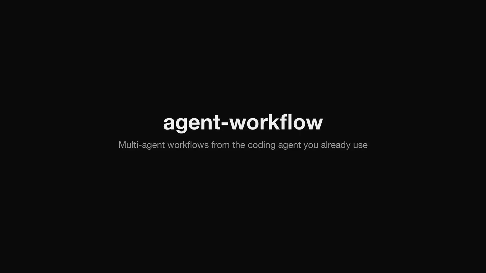
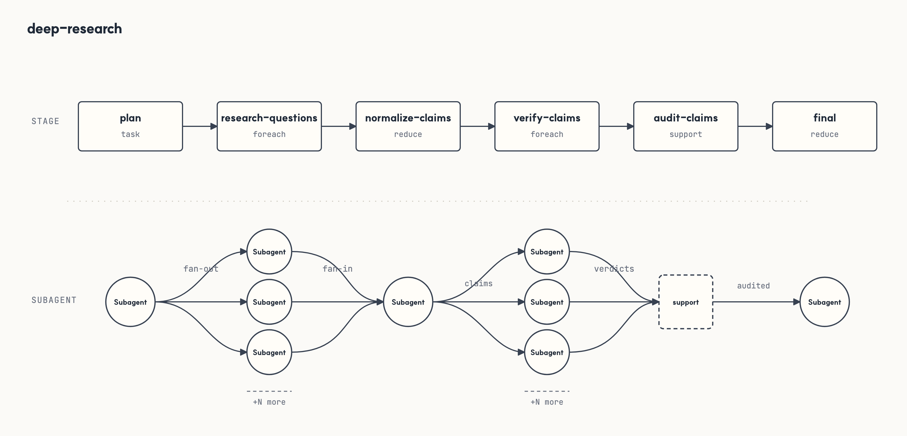
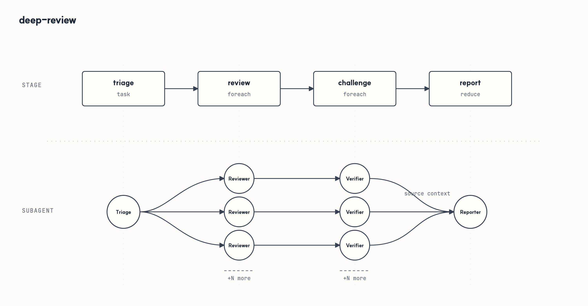
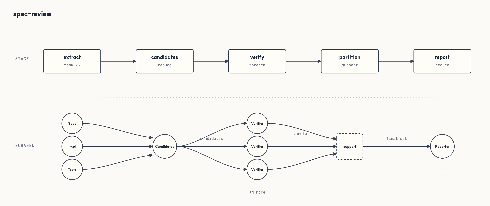
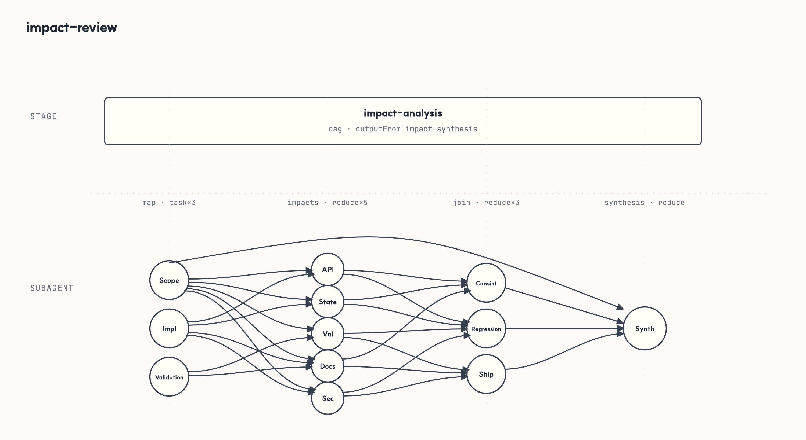
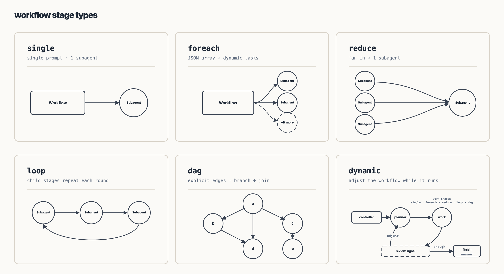

<p align="center">
  
</p>

<h1 align="center">agent-workflow</h1>

<p align="center"><strong>Repeatable multi-agent workflows on the coding-agent CLIs you already use.</strong></p>

<p align="center">
  <a href="https://github.com/AgwaB/agent-workflow/actions/workflows/ci.yml"></a>
  <a href="LICENSE"></a>
</p>

agent-workflow runs named, repeatable multi-step workflows — deep research, code review, spec conformance,
impact review, or your team's own routines — on **Claude Code**, **Codex**, **Pi** and, experimentally,
**Antigravity**. Each step runs as a worker on the CLI you choose; the engine passes results between steps, checks
them, and records the run so you can watch, stop or resume it.

<p align="center">
  
</p>

> **Pre-release.** Not on npm yet; breaking changes are expected before 1.0. Until the first release,
> [install from source](docs/hosts.md#requirements-and-installing-from-source).

## Quick start

Install it where you type; the CLIs that do the work only need to be logged in.

**Claude Code**

```sh
claude plugin marketplace add AgwaB/agent-workflow
claude plugin install agent-workflow@agent-workflow
```

**Codex**

```sh
codex plugin marketplace add AgwaB/agent-workflow
codex plugin add agent-workflow@agent-workflow
```

**Pi**

```sh
pi install npm:@agwab/agent-workflow
```

**Terminal**

```sh
npm install -g @agwab/agent-workflow
```

Requirements, MCP-only setup and other hosts: [Hosts](docs/hosts.md).

## Ask in plain language

Describe what you need and say it should go through agent-workflow. The agent picks the workflow that fits, starts
it and reports back:

```text
Look into how the major web servers support HTTP/3 these days, with sources. Use agent-workflow.
```

```text
Have agent-workflow review what I changed today before I open the PR.
```

```text
Does our API still match docs/API_SPEC.md? Check it with a workflow.
```

```text
What could break if I merge this branch? Run it through agent-workflow.
```

To choose the workflow yourself, name it: `Use deep-review on the current diff, focusing on concurrency.`

## Or use a command

| Where | Command |
|---|---|
| Claude Code | `/aw run deep-review "Review the current diff"` |
| Codex | `$aw run deep-review "Review the current diff"` |
| Pi | `/aw run deep-review "Review the current diff"` |
| Terminal | `agent-workflow run deep-review "Review the current diff" --executor claude` |

`auto <task>` picks a workflow for you; `dynamic <task>` plans a one-off one. Every launch prints a link to the
local dashboard, where you watch the run, read the report and stop it. All commands: [CLI](docs/cli.md).

By default workers run without approval prompts or a sandbox; use
[`--permission-mode safe`](docs/usage.md#permission-modes) to enforce read-only stages and approvals.

## Bundled workflows

| Workflow | Use it when |
|---|---|
| `deep-research` | a question needs sources: comparisons, the state of a field, fact checks |
| `deep-review` | a diff or design deserves more than one reviewer pass |
| `spec-review` | an implementation must match a spec, an API contract or acceptance criteria |
| `impact-review` | a change is about to be merged or released |









More on each: [bundled workflows](docs/usage.md#bundled-workflows).

## Write your own

A workflow is a JSON graph of stages. The bundled `workflow-guide` skill writes and validates one for you:

```text
Use workflow-guide to create a release-readiness workflow: inspect docs, tests and recent changes,
then produce a checklist.
```



Stages, helpers and the spec format: [Usage](docs/usage.md#stage-model).

## Documentation

| Guide | For |
|---|---|
| [Usage](docs/usage.md) | Running and writing workflows: stages, profiles, permission modes, bundled workflows |
| [CLI](docs/cli.md) | Every `agent-workflow` command |
| [Hosts](docs/hosts.md) | Installing in Claude Code, Codex and Pi; the dashboard |
| [Executors](docs/executors.md) | How each CLI is driven, and what is verified |
| [Extending](docs/extending.md) | Writing an executor adapter or another host |

Contributing: [CONTRIBUTING.md](CONTRIBUTING.md). Security: [SECURITY.md](SECURITY.md). License: MIT ([LICENSE](LICENSE), [NOTICE](NOTICE)).
